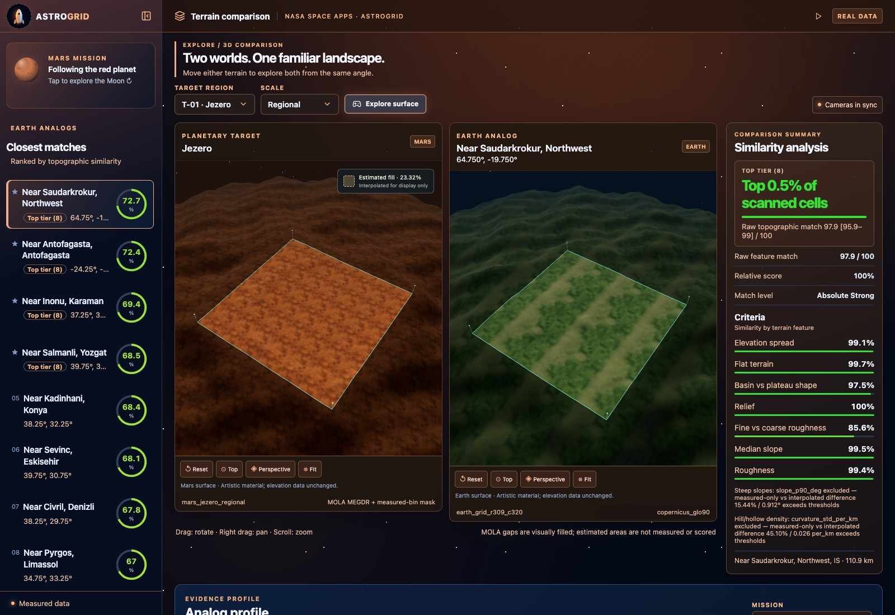
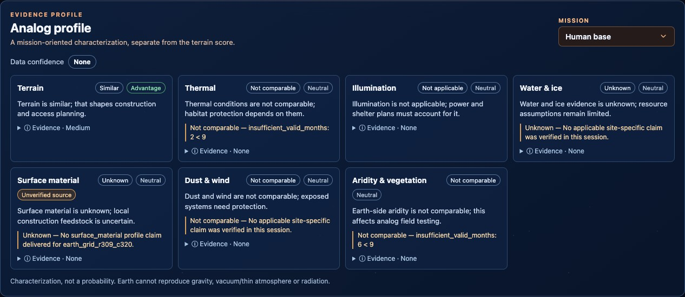
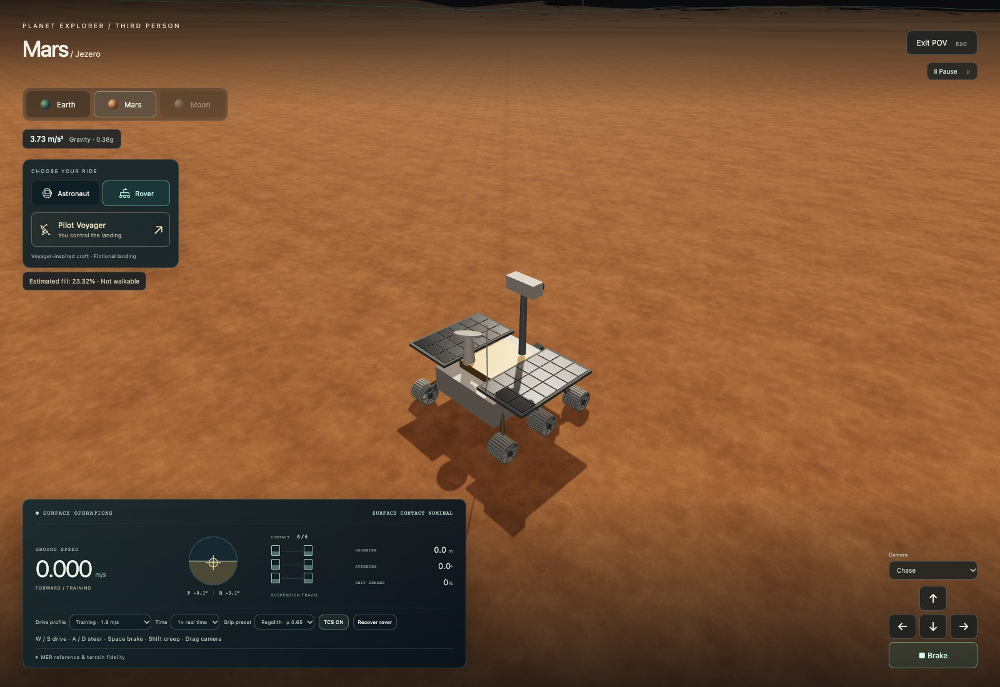
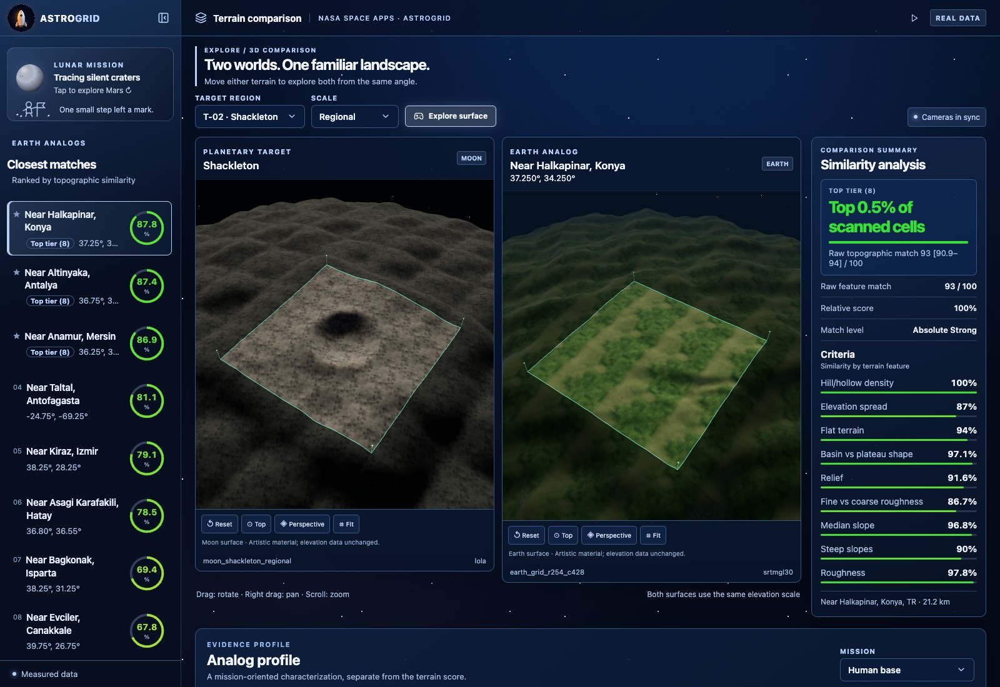
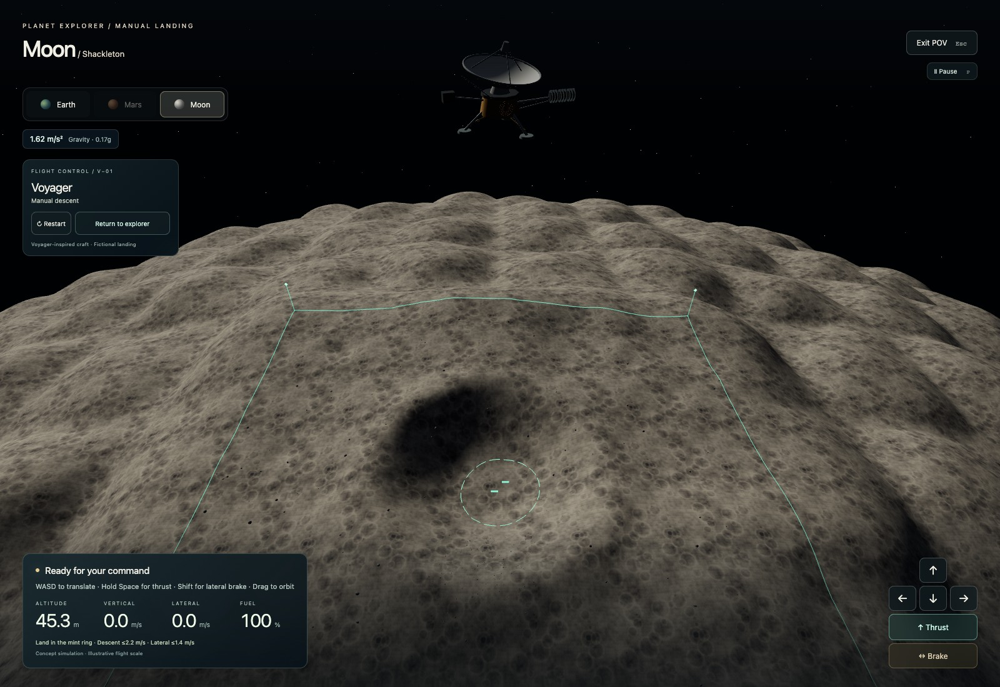

<div align="center">


# AstroMatch AI · AstroGrid

**Two worlds. One familiar landscape.**

Explore Mars and the Moon in 3D, discover topographic analogs on Earth, and inspect what makes them similar.

[](https://github.com/ahmet-talha-yuksel/astromatch/actions/workflows/ci.yml)


[Quick start](#quick-start) · [Screenshots](#screenshots) · [How matching works](#how-matching-works) · [Data & sources](#data--sources)

</div>



AstroMatch AI connects planetary elevation data with Earth terrain. Its AstroGrid interface places both surfaces side by side, synchronizes their cameras, and explains the comparison feature by feature. An immersive explorer lets you walk the selected parcel, drive a six-wheel rover, or pilot a fictional landing craft.

**The scores describe topographic similarity. They are not probabilities of a true planetary analog or assessments of landing safety.**

## What you can do

| Feature | In the application |
| --- | --- |
| **Compare two worlds** | View a Mars or lunar target alongside an Earth candidate, with synchronized rotation and zoom. |
| **Find Earth analogs** | Browse ranked candidates, nearby place names, top-tier groups, uncertainty intervals and scanned-cell percentiles when available. |
| **Inspect the match** | See contributions from slope, relief, flat terrain, roughness and eligible shape descriptors, plus reasons for excluded features. |
| **Read the Analog Profile** | Change mission context and inspect terrain, thermal, vegetation, water/ice, material, illumination and dust/wind evidence separately from the ranking. |
| **Explore the surface** | Switch between astronaut and rover modes, choose first/third person views, and move between the loaded planetary and Earth terrains. |
| **Drive a rover** | Use six wheel contacts, suspension, steering, progressive acceleration, braking and planet-specific gravity. |
| **Pilot a landing** | Manually control a Voyager-inspired craft with altitude, velocity, fuel and touchdown feedback. |
| **Trace the data** | Inspect source provenance, measured-data masks and clearly labeled visual estimates. Annual MODIS context is available in the processing exports. |

## Screenshots

### Evidence beyond the terrain score



Choose **Human base**, **Rover ops**, **Astrobiology** or **Analog testing** to inspect mission-oriented context. The panel keeps unknown values, source links and verification status visible. It characterizes additional evidence without combining it into the terrain score. Source review is tracked in [PROFILE_REVIEW.md](processing/out/real/PROFILE_REVIEW.md).

### Walk, drive, explore



The rover has Chase and Mast cameras, a responsive training profile, and a separate MER reference-speed profile. Parcel boundaries and the original measured-data mask constrain travel. The reference panel also includes an original Opportunity coordinate-product study.

### From lunar craters to Earth terrain



Change mission and target region to inspect another landscape. Surface colors and materials are artistic; the elevation geometry comes from the loaded DEM. Generated surroundings provide visual context around the selected parcel.

<details>
<summary><strong>See the manual landing simulator</strong></summary>



**Pilot Voyager** starts a manual descent exercise. Control thrust, lateral movement and braking, then aim for a supported touchdown inside the landing zone. This is a fictional Voyager-inspired craft and an illustrative flight exercise, not a reconstruction of an actual Voyager landing.

</details>

All five images are captures of the running application. To regenerate them, see [the screenshot capture script](docs/capture_screenshots.py).

## Quick start

### Docker Compose

From the repository root, with Docker and Compose installed:

```bash
git clone https://github.com/ahmet-talha-yuksel/astromatch.git
cd astromatch
docker compose up --build
```

| Service | Address |
| --- | --- |
| AstroGrid interface | [localhost:5173](http://localhost:5173) |
| API documentation | [localhost:8000/docs](http://localhost:8000/docs) |
| Active data mode and health | [localhost:8000/api/v1/health](http://localhost:8000/api/v1/health) |

The repository includes processed data and a frozen results snapshot; you do not need to download raw planetary rasters to try the application. The health endpoint reports whether real or mock data is active.

For the separate terrain viewer:

```bash
docker compose --profile terrain3d up --build
```

Open [localhost:5174](http://localhost:5174). Stop the stack with `docker compose down`.

### Local development

Use Python 3.12+ and Node.js 22. From the repository root:

```bash
python3 -m venv .venv
source .venv/bin/activate
python -m pip install -r backend/requirements.txt -r engine/requirements.txt
uvicorn backend.app.main:app --reload
```

In a second terminal:

```bash
cd frontend
npm ci
npm run dev
```

The frontend defaults to `http://localhost:8000` for its API. Set `VITE_API_BASE_URL` when using a different backend address. For data modes, input paths and precomputation, see [Docker configuration](docs/docker.md). Raw-data processing has a separate environment and setup described in [processing/README.md](processing/README.md).

## Controls

| Mode | Controls |
| --- | --- |
| Terrain comparison | Drag to rotate · right-drag to pan · scroll to zoom · Reset / Top / Perspective / Fit |
| Astronaut | W/A/S/D or arrows to move · Shift to move faster · Space to jump · drag to look |
| Rover | W/S to drive and reverse · A/D to steer · Space to brake · Shift for a slow training crawl |
| Manual landing | W/A/S/D for lateral thrust · hold Space for main thrust · Shift for lateral braking |
| Explorer | P to pause/resume · Esc to exit · on-screen controls support touch |

Rover mode starts in **Training at 1×**. The selectable **MER reference** profile uses a 0.05 m/s target speed; time acceleration is configured separately. Rover physics uses real DEM meters and physical relief at 1×. See [the rover model and its assumptions](terrain3d/ROVER_SIMULATOR.md).

## How matching works

1. **Prepare comparable terrain.** Extract features from fixed physical windows with documented source resolution, coordinate system, missing-data support and processing method.
2. **Apply eligibility gates.** Use non-null, explicitly comparable features at matching scales. Features that fail measurement-support or sensitivity checks are excluded with reasons.
3. **Calculate the match.** Compare eligible features with calibrated similarity functions and combine them with a weighted geometric mean.
4. **Explain the result.** Show per-feature similarities, uncertainty, relative ranking, top-tier groups and how common a terrain match is among eligible scanned cells.

The feature set includes slope, flat fraction, relief, elevation spread and roughness. Additional descriptors capture **basin/plateau shape**, **fine/coarse roughness**, and **hill/hollow density**. Their availability depends on the target's data support and validation checks.

Temperature, NDVI, ice, mineralogy and atmosphere are separate context; they do not become topographic score inputs just because a value is available. Missing values remain `null` with reasons. A measured zero remains a valid zero.

Read the [engine methodology](engine/METHODOLOGY.md), [processing methods](processing/README.md) and [morphology definitions](processing/MORPHOLOGY.md) for the detailed contracts.

## Data & sources

| Layer | Sources | Documentation |
| --- | --- | --- |
| Mars elevation | MGS MOLA MEGDR and measured-bin support masks | [Mars measured exports](processing/out/mars_measured/DATA_SOURCES.md) |
| Lunar elevation | LRO LOLA products and measurement-support checks | [Source provenance](processing/out/real/DATA_SOURCES.md) |
| Earth elevation | SRTMGL30 and Copernicus DEM, selected by region and scale | [Processing pipeline](processing/README.md) |
| Earth surface temperature | MODIS Terra **MOD11C3.061**, monthly 2025 inputs | [Dataset DOI](https://doi.org/10.5067/MODIS/MOD11C3.061) |
| Vegetation context | MODIS Terra **MOD13C2.061**, monthly 2025 inputs | [Dataset DOI](https://doi.org/10.5067/MODIS/MOD13C2.061) |
| Rover reference | MER dimensions and speed references; an Opportunity PDS coordinate product | [Sources and model limits](terrain3d/ROVER_SIMULATOR.md) |
| Nearby place labels | GeoNames, via `reverse_geocoder` | [Attribution](engine/DATA_SOURCES.md) |

The canonical regional Earth scan contains **408 cells**, of which **216 pass the comparison eligibility checks**. Additional expansion and validation datasets are stored separately; this is not a completed global survey.

The 2025 MODIS context uses 12 monthly files per product, product-specific QA and at least nine valid months for an annual quantity. Missing temperature coverage and unvalidated cells remain explicit. IMERG precipitation inputs have not been supplied in this release. See the [annual context coverage report](processing/out/real/context_report.md).

Raw HDF/raster downloads, caches and account credentials are excluded from Git. Reproducing raw-data acquisition may require an Earthdata account; browsing the included processed data does not.

## Scope and interpretation

- **Similarity is feature-specific.** A similar landscape does not establish equivalent chemistry, radiation, habitability or mission suitability.
- **Visual estimates are labeled.** Display-only gap filling and generated surroundings are not promoted to measured terrain or used as rover collision data.
- **The rover is an engineering approximation.** Suspension, grip and motor response are not calibrated mission telemetry. Coarse DEMs do not resolve wheel-sized rocks, sinkage or soil deformation.
- **Mock data is distinct.** Synthetic fixtures remain labeled and separate from real-data processing outputs.

For further details, see [scientific limitations](docs/scientific_limitations.md) and [known issues](docs/known-issues.md).

## Development & checks

```bash
# API and similarity engine (backend + engine dependencies)
python -m pytest validation/test_similarity.py engine/tests backend

# Frontend type-check and production build
cd frontend
npm run build

# Terrain geometry, navigation and vehicle physics
cd ../terrain3d
npm test
```

Processing tests, acquisition commands and data regeneration are documented in [processing/README.md](processing/README.md). The [terrain viewer documentation](terrain3d/README.md) includes browser checks for synchronized cameras, parcel containment, rover controls and manual landing.

## Repository map

| Directory | Responsibility |
| --- | --- |
| [`frontend/`](frontend/) | AstroGrid comparison interface, candidate list and mission navigation |
| [`terrain3d/`](terrain3d/) | Shared Three.js / React Three Fiber viewer, explorer and Rapier rover physics |
| [`backend/`](backend/) | FastAPI endpoints, dataset modes and terrain delivery |
| [`engine/`](engine/) | Eligibility, calibrated similarity, ranking, explanations and reports |
| [`processing/`](processing/) | DEM acquisition, measured-data QA, morphology and climate context |
| [`discovery/`](discovery/) | Candidate discovery and known-analog references |
| [`shared/`](shared/) | Data contracts and schemas |
| [`validation/`](validation/) | Cross-module validation checks |
| [`docs/`](docs/) | Architecture, integration, limitations and screenshots |

---

<div align="center">

**Explore the terrain. Inspect the evidence. Understand the match.**

[Architecture](docs/architecture.md) · [API integration](docs/integration.md) · [Engine reports](engine/report/INDEX.md)

</div>
