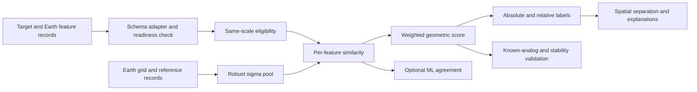

# AstroMatch AI similarity methodology

AstroGrid compares measured or derived terrain features of Moon/Mars targets with Earth sites and grid cells. A real run first checks the input records for schema fields, data status, comparability, resolution validation, and at least one Earth site with three eligible features per target.

**Eligibility.** A target and Earth candidate must have the same `scale`; Earth candidates require validated resolution, and non-null feature values explicitly marked `comparable: true` on both sides. A target feature with a supplied sensitivity `pass=false` is excluded even if its comparable flag is true; that inconsistency is logged. A target remains scorable when at least three eligible features remain. For a target flagged unvalidated only because per-feature sensitivity failed, the engine may apply the delivered pass/fail verdicts directly when measured support exists, effective NoData meets the supplied limit, and no other failure reason is present. Passed features are usable even when the producer marked all features non-comparable as a group; failed features remain excluded. Excluded features and their supplied differences are listed with the target and in explanations. `earth_site` and `earth_grid` records can be ranked; `earth_reference` records contribute **only** to sigma pools. Unknown features are ignored with warnings. Earth vegetation, precipitation, and land-fraction thresholds add flags; they affect inclusion only when `filter_mode=exclude` is requested.

**Similarity and sigma.** Each configured feature can use Gaussian `exp[-½((x−t)/σ)²]`, a trapezoid with a flat central band, or a one-sided linear threshold. By default, the engine forms a same-scale pool from eligible Earth grid cells, then references, then sites if needed. For each scale and preset, it treats each pool cell as a pseudo-target and scores it against every other cell. Seeded subsampling caps the pool at 512; bisection searches `k` in [0.05, 2] for a median leave-one-out pairwise geometric score of 50. Each feature uses `sigma_f = k × 1.4826 × MAD_f`. The calibration record stores `k`, method `loo_median50`, sample and pair counts, pool kind, seed, and achieved median. It is deterministic and cached for unchanged inputs. Config `sigma_calibration: fixed_k` restores the older `k=0.5` rule for comparison. Local real data currently has only eight Earth sites, so calibration uses those sites. If the pool or feature spread is insufficient, a configured fixed default applies and its source is reported.

**Transformed terrain metrics.** Slopes, TRI, relief, and elevation spread use `ln(max(x,0)+ε)` with measurement floors of 0.05° for slopes, 0.5 m for TRI, 2 m for relief, and 1 m for elevation spread. Flat fraction uses logit after clipping to [0.01, 0.99]. The Gaussian difference, robust Earth standard deviation, LOO calibration, and standardized ranking distance all use this transformed space. The floors prevent undefined logs near zero; they are not tuned to a target or control site.

**Shape feature set.** `feature_set: v9` is the default; `--feature-set v6` reproduces the prior six-feature set. The v9 shape group adds hypsometric integral (identity transform), roughness ratio (`ln(max(x,0)+0.01)`), and curvature standard deviation per km (`ln(max(x,0)+0.001)`). The curvature floor is an engineering numerical floor in units of km⁻¹; it is not a measured detection limit. Four groups (slope, roughness, relief, shape) receive equal base weight, split equally within each group, before preset multipliers. The older v6 set retains three equal groups. Zero roughness ratio is permitted because water or salt surfaces can be flattened by the DEM; scored records carry `possible_flattened_surface`. Missing shape values on resolution-unvalidated Earth cells do not enter calibration or ranking. The current measured Mars records supply shape-feature sensitivity verdicts: Phoenix has nine eligible features, Arcadia eight, and Jezero regional seven. Failed features are excluded individually, and a missing shape verdict also excludes that feature. Marius has a measured-only record, but its producer explicitly withholds resolution validation, so it remains unscorable.

**Top tier.** A scored candidate belongs to the top tier if its 90% Monte Carlo score interval overlaps the interval of the first distance-ranked candidate. The result reports `top_tier` and `top_tier_size`. This is an interval-overlap grouping, not a formal equivalence test.

**Score and labels.** The configured features are grouped as slope (`slope_median_deg`, `slope_p90_deg`, `flat_fraction`), roughness (`tri_median_m`, `elevation_std_m`), relief (`relief_m`), and, for v9, shape (`hypsometric_integral`, `roughness_ratio`, `curvature_std_per_km`). Each active group receives equal base weight, split equally among its features; preset multipliers then apply, and eligible weights are renormalized. The primary absolute score is `100 × exp[Σ wᵢ′ log(max(sᵢ, 0.01))]`. The geometric mean makes a very weak criterion constrain the total instead of being fully offset by stronger criteria. The arithmetic comparison uses the same 0.01 floor; a gap of at least 15 points adds `weak_link`. Relative ordering uses `distance_z = sqrt(Σ wᵢ′ ((xᵢ−tᵢ)/max(1.4826×MADᵢ, floorᵢ))²)`, with the same eligible features and a deterministic ID tie-break. The closest Earth record has `score_relative=100`; others use `100/(1+distance_z−best_distance_z)`. This avoids ties when geometric scores hit their 0.01 per-criterion floor. It is a *rank context*, not evidence of a close analog. Absolute scores at least 80 are `absolute_strong`, and scores from 60 to below 80 are `absolute_moderate`. Below 60, local candidates with relative score at least 90 and regional candidates in the top 5% are `relative_only`; the rest are `weak`. For at least 20 eligible candidates, a 95th-percentile absolute score below 40 means `uniformly_dissimilar`; for smaller sets, the maximum is used. Otherwise, a span below 2 points among the ten best absolute scores means `poorly_discriminated`; all other scorable sets are `discriminated`. Median and standard deviation are reported separately. Every ranking explanation states the topographic scope and omitted physical properties.

**Terrain commonality.** For each target, scale, and preset, the engine counts eligible scanned Earth grid cells with absolute `score_geo` at least 90 and at least 80. Shares use eligible scanned grid cells as the denominator; Earth sites and unscanned cells are excluded. When at least 10% score 90 or higher, explanations say that this topography is common in the scanned area and that non-topographic properties are needed to identify an analog. With no eligible grid cells, the shares are null.

**Contextual terrain score.** The displayed score discounts the raw geometric score when high terrain similarity is common in the scanned grid: `score_contextual = score_geo × [1 − (share_ge_80 + share_ge_90)/2]`. The factor is constant for a target, scale, and preset, so candidate order is unchanged. When no eligible grid cells exist, the factor is 1 and the raw score is retained. Confidence interval endpoints use the same factor. This is a descriptive commonality adjustment over the **regional subset**, not a probability of geological equivalence. The raw `score_geo` remains available for inspection and comparison with per-feature similarities.

**Score uncertainty.** CLI runs precompute 200 seeded Monte Carlo perturbations per target, scale, and preset. Each draw independently scales feature sigma by a uniform factor from 0.8 to 1.2, samples normalized feature weights from a Dirichlet distribution with concentration 50, and perturbs target and candidate feature values with Gaussian noise. An explicit numeric per-feature uncertainty in `features`, `quality.feature_uncertainty`, `quality.uncertainty`, or `measurement_support.feature_uncertainty` takes precedence; otherwise the noise standard deviation is 5% of that feature's robust Earth standard deviation (1.4826 × MAD). This is an engineering sensitivity interval, not a calibrated probability of geological equivalence. The exported `score_ci_low/high` are the fifth and 95th score percentiles, expanded to contain the unperturbed score; `rank_p5/p95` and `top10_stability` use the engine's distance-based ordering over eligible Earth candidates. The same seed and inputs yield the same values. The API serves precomputed ranking files when configured to use the demo directory, and computes the same intervals when no matching file is available.

**Ranking, confidence, and validation.** `score_percentile_scanned` is the percentage of eligible scanned Earth grid cells whose absolute score is strictly below a candidate's; it describes the scanned subset, not Earth globally. The validation report includes pairwise Spearman correlations of the configured features over eligible regional grid cells. Top-k results apply haversine spatial separation (20 km local; 150 km regional), while local site-card exports retain every site without NMS. Optional kNN uses robust median/MAD normalization of the same features; HDBSCAN clustering adds a third agreement signal when installed. PCA exports exclude reference records. ML agreement never changes the primary score and is **methodological robustness, not independent confirmation**, because methods share inputs. Validation reports known-analog ranks, recall at 1/5/10%, and seeded weight/noise stability. ROC/AUC is skipped unless explicit negative examples are supplied.

**Earth limits.** Topographic resemblance does not establish equivalent gravity, atmospheric pressure, radiation, mineralogy, illumination, habitability, or landing safety. Body-limit statements come from `config/body_limits.yaml`; temperature is excluded unless explicitly comparable. No number in a result should be interpreted as a NASA measurement when its data status is `mock`.

## Mars measurement support

An optional `measurement_support` object describes measured-only Mars processing. The delivered method may use a plane fit with at least 6 of 9 measured neighbours; the engine records the supplied `min_measured_neighbors` but does not recreate DEM pixels. Raw unmeasured fraction and effective NoData fraction are distinct. Effective NoData and sensitivity results are reported as measurement diagnostics. A failed feature sensitivity excludes that feature; the target remains scorable with at least three eligible features. Data production may mark a sensitivity feature as passing when relative change is at most 15% **or** absolute change is within that feature's supplied tolerance; these are engineering thresholds, not scientific validation of Mars terrain. The engine consumes the supplied pass flags rather than recalculating them. The `target_confidence` coverage band is high at effective NoData ≤10% or with no support metadata, medium at 10–20%, and low at 20–30%. It does **not** override `resolution_validated`; an unvalidated target can still carry the high coverage band when support metadata is absent. A measured-only versus interpolated ranking comparison uses identical sigma and weights; it reports Spearman correlation, top-10 Jaccard, Turkish-site rank shift, and per-site score changes. Spearman below 0.8 flags the target as method-sensitive. Explanations state that interpolated MOLA values were not used for the primary score.

## Limitations of the delivered real data

The currently delivered Jezero local record is not resolution validated; its score remains unavailable. The measured-only Jezero regional record also fails its supplied p90-slope sensitivity threshold. Phoenix regional and Arcadia regional are validated measured-only records with the same method; Marius Hills regional remains unvalidated. The 408-cell Earth grid is a **regional subset**: 216 cells pass comparison checks, while coverage polygons mark unscanned cells separately from scored and non-comparable cells. No local Earth-reference pool has been delivered, so real local calibration uses the eight eligible Earth sites. Similarity describes only the configured terrain measurements and cannot establish Earth/Mars physical equivalence. The Mars records used for this snapshot were read from the data branch at the revision recorded in the manifest; no processing files are modified by the engine.

## Analog profile

The Analog profile is a **categorical characterization**, separate from the terrain ranker. It never changes `score_geo`, candidate order, or the similarity formula and has no combined score or probability. Missing inputs remain **Not comparable** or **Unknown**. Each row carries target and Earth summaries, evidence tiers, sources, a note, and a mission-specific impact. The response states that Earth cannot reproduce planetary gravity, vacuum or thin atmosphere, or radiation.

Inputs are optional `context` quantities on v2.3 feature records or `ctx__*` columns in the Earth grid. JSON quantities carry `value`, `source`, `period`, `evidence`, and optional `reason`/`warnings`; flattened grid columns carry the value plus `__n_valid_months`, `__warnings`, and `__reason`. Null reasons are returned in the API and shown in the UI. Grid columns without per-cell provenance can be labeled when populated, but their confidence stays None until evidence metadata is delivered. The cold-extreme rule additionally needs an actual Earth minimum (`lst_absolute_min_c`); a monthly average does not stand in for one. Optional `processing/out/real/target_profiles.json` uses schema `profile-1.0` with `targets` and `earth_sites` lists (the earlier `records` list remains accepted). Sourced claims require category, summary, evidence and source title/URL or DOI; an `unknown` or `not_applicable` item may have null source and summary. Missing sources on a substantive claim are rejected by `cli check`. `verified_by: null` is retained as an unverified sourced claim and surfaced as `verified: false`; it is not silently treated as verified. The mock file in `engine/fixtures/target_profiles.json` uses `MOCK SOURCE` and `mock://` and is never evidence about actual locations. The delivered Diviner PRP average is 2 cm subsurface rather than surface temperature, so it remains null with its stated reason.

The following thresholds are read from [`config/profile_rules.yaml`](config/profile_rules.yaml); that YAML is the authority for runtime decisions:

| Dimension | Decision |
| --- | --- |
| Terrain | Scanned-cell percentile ≥90: Similar; ≥70: Partly; otherwise Different. Raw topographic score and its interval are shown separately. Without a percentile: Not comparable. |
| Thermal | Compare the same surface-temperature quantity. Prefer diurnal range; use ratio target/Earth. Similar within 0.67–1.5; Partly within 0.4–2.5; otherwise Earth cannot reproduce. Absolute Celsius temperatures are converted to Kelvin before division. A planetary surface minimum more than 50°C below the Earth comparison minimum is Earth cannot reproduce. Missing or unmatched quantities: Not comparable. |
| Aridity and vegetation | Earth-side analog quality only: Good when NDVI <0.15 and precipitation <250 mm/year; Moderate when both are <0.3 and <500; otherwise Poor. Missing either: Not comparable. |
| Water and ice | Matching categories: Shared evidence type; differing categories: Different; missing side: Unknown. This does not establish equal resource abundance. |
| Surface material | Case-insensitive mineral-list intersection: Overlap with the shared names; no intersection: No overlap; missing side or list: Unknown. |
| Illumination | Moon target at absolute latitude ≥80°: Earth cannot reproduce polar grazing sunlight or permanent shadow; otherwise Not applicable. |
| Dust and wind | Mars target with sourced dust evidence and a dry Earth aridity proxy: Partly. Missing evidence/proxy: Not comparable. Moon: Not applicable because it lacks an atmosphere. |

Evidence levels are High for `direct_measurement`, Medium for `orbital_remote_sensing`, Low for `model` or `literature_synthesis`, and None when missing. A dimension's confidence is the lower of its available sides when both are required; overall confidence is the lowest displayed dimension. `engine/config/mission_profiles.yaml` defines the order and categorical impact (`advantage`, `risk`, `opportunity`, `neutral`) for Human base, Rover ops, Astrobiology, and Analog testing. Mission selection changes order, impact, and rationale, never labels or terrain ranking. There is no numeric aggregation because the dimensions describe different physical claims and some have no comparable Earth counterpart.
