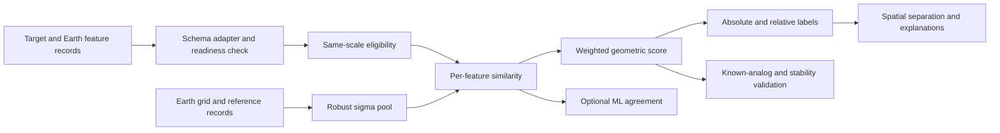

# AstroMatch AI similarity methodology

AstroMatch compares measured or derived terrain features of Moon/Mars targets with Earth sites and grid cells. Checked-in demo results use **mock data** and are not scientific findings. A real run first checks the input records for schema fields, data status, comparability, resolution validation, and at least one Earth site with three eligible features per target.

**Eligibility.** A target and Earth candidate must have the same `scale`, validated resolution on both records, and non-null feature values explicitly marked `comparable: true` on both sides. At least three configured features must qualify. `earth_site` and `earth_grid` records can be ranked; `earth_reference` records contribute **only** to sigma pools. Unknown features are ignored with warnings. Earth vegetation, precipitation, and land-fraction thresholds add flags; they affect inclusion only when `filter_mode=exclude` is requested.

**Similarity and sigma.** Each configured feature can use Gaussian `exp[-½((x−t)/σ)²]`, a trapezoid with a flat central band, or a one-sided linear threshold. For robust sigma, the engine uses `max(floor, k × 1.4826 × MAD)` from non-null `earth_grid` and `earth_reference` values at the same scale when at least 200 samples exist. Otherwise it borrows their regional distribution; if that is absent, it uses a configured engineering fallback. Each result records `sigma_source` and `n_samples`. The fallback values are not measured calibration parameters.

**Score and labels.** Eligible weights are renormalized. The primary absolute score is `100 × exp[Σ wᵢ′ log(max(sᵢ, 0.01))]`. The geometric mean makes a very weak criterion constrain the total instead of being fully offset by stronger criteria. The arithmetic comparison uses the same 0.01 floor; a gap of at least 15 points adds `weak_link`. `score_relative` sets the best scored Earth candidate for that target, scale, and preset to 100. It is a *rank context*, not evidence of a close analog. Absolute scores at least 80 are `absolute_strong`, and scores from 60 to below 80 are `absolute_moderate`. Below 60, local candidates with relative score at least 90 and regional candidates in the top 5% are `relative_only`; the rest are `weak`. The relative-only explanation says that no close absolute Earth analog was found.

**Ranking, confidence, and validation.** Top-k results apply haversine spatial separation (20 km local; 150 km regional), while local site-card exports retain every site without NMS. Optional kNN uses robust median/MAD normalization of the same features; HDBSCAN clustering adds a third agreement signal when installed. PCA exports exclude reference records. ML agreement never changes the primary score and is **methodological robustness, not independent confirmation**, because methods share inputs. Validation reports known-analog ranks, recall at 1/5/10%, and seeded weight/noise stability. ROC/AUC is skipped unless explicit negative examples are supplied.

**Earth limits.** Topographic resemblance does not establish equivalent gravity, atmospheric pressure, radiation, mineralogy, illumination, habitability, or landing safety. Body-limit statements come from `config/body_limits.yaml`; temperature is excluded unless explicitly comparable. No number in a result should be interpreted as a NASA measurement when its data status is `mock`.
