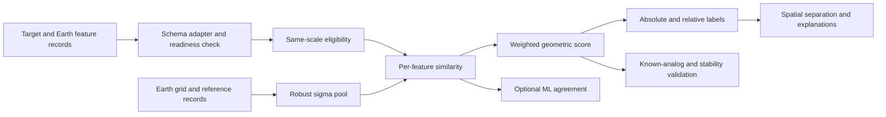

# AstroMatch AI similarity methodology

AstroMatch compares measured or derived terrain features of Moon/Mars targets with Earth sites and grid cells. Checked-in demo results use **mock data** and are not scientific findings. A real run first checks the input records for schema fields, data status, comparability, resolution validation, and at least one Earth site with three eligible features per target.

**Eligibility.** A target and Earth candidate must have the same `scale`, validated resolution on both records, and non-null feature values explicitly marked `comparable: true` on both sides. At least three configured features must qualify. `earth_site` and `earth_grid` records can be ranked; `earth_reference` records contribute **only** to sigma pools. Unknown features are ignored with warnings. Earth vegetation, precipitation, and land-fraction thresholds add flags; they affect inclusion only when `filter_mode=exclude` is requested.

**Similarity and sigma.** Each configured feature can use Gaussian `exp[-½((x−t)/σ)²]`, a trapezoid with a flat central band, or a one-sided linear threshold. For real regional runs, the engine uses `max(floor, k × 1.4826 × MAD)` from validated, comparable `earth_grid` values when at least 150 per feature exist. This engineering threshold is below the 216 eligible cells in the delivered regional subset. Real local runs use validated, comparable `earth_reference` values when at least 100 exist. Otherwise either scale uses `fixed_default`, with zero calibration samples. Mock runs retain the earlier 200-sample regional pooling rule. Each result records `sigma_source` and `n_samples`. Fallback values are engineering defaults, not measured calibration parameters.

**Score and labels.** Eligible weights are renormalized. The primary absolute score is `100 × exp[Σ wᵢ′ log(max(sᵢ, 0.01))]`. The geometric mean makes a very weak criterion constrain the total instead of being fully offset by stronger criteria. The arithmetic comparison uses the same 0.01 floor; a gap of at least 15 points adds `weak_link`. Relative ordering uses `distance_z = sqrt(Σ wᵢ′ ((xᵢ−tᵢ)/max(1.4826×MADᵢ, floorᵢ))²)`, with the same eligible features and a deterministic ID tie-break. The closest Earth record has `score_relative=100`; others use `100/(1+distance_z−best_distance_z)`. This avoids ties when geometric scores hit their 0.01 per-criterion floor. It is a *rank context*, not evidence of a close analog. Absolute scores at least 80 are `absolute_strong`, and scores from 60 to below 80 are `absolute_moderate`. Below 60, local candidates with relative score at least 90 and regional candidates in the top 5% are `relative_only`; the rest are `weak`. For at least 20 eligible candidates, a 95th-percentile absolute score below 40 means `uniformly_dissimilar`; for smaller sets, the maximum is used. Otherwise, a span below 2 points among the ten best absolute scores means `poorly_discriminated`; all other scorable sets are `discriminated`. Median and standard deviation are reported separately. Every ranking explanation states the topographic scope and omitted physical properties.

**Terrain commonality.** For each target, scale, and preset, the engine counts eligible scanned Earth grid cells with absolute `score_geo` at least 90 and at least 80. Shares use eligible scanned grid cells as the denominator; Earth sites and unscanned cells are excluded. When at least 10% score 90 or higher, explanations say that this topography is common in the scanned area and that non-topographic properties are needed to identify an analog. With no eligible grid cells, the shares are null.

**Ranking, confidence, and validation.** Top-k results apply haversine spatial separation (20 km local; 150 km regional), while local site-card exports retain every site without NMS. Optional kNN uses robust median/MAD normalization of the same features; HDBSCAN clustering adds a third agreement signal when installed. PCA exports exclude reference records. ML agreement never changes the primary score and is **methodological robustness, not independent confirmation**, because methods share inputs. Validation reports known-analog ranks, recall at 1/5/10%, and seeded weight/noise stability. ROC/AUC is skipped unless explicit negative examples are supplied.

**Earth limits.** Topographic resemblance does not establish equivalent gravity, atmospheric pressure, radiation, mineralogy, illumination, habitability, or landing safety. Body-limit statements come from `config/body_limits.yaml`; temperature is excluded unless explicitly comparable. No number in a result should be interpreted as a NASA measurement when its data status is `mock`.

## Mars measurement support

An optional `measurement_support` object describes measured-only Mars processing. The delivered method may use a plane fit with at least 6 of 9 measured neighbours; the engine records the supplied `min_measured_neighbors` but does not recreate DEM pixels. Raw unmeasured fraction and effective NoData fraction are distinct. The engine refuses a target when effective NoData exceeds the supplied maximum (default 0.30). It also refuses a target marked `resolution_validated=true` when any supplied feature sensitivity result has `pass=false`, and logs the disagreement. Data production may mark a sensitivity feature as passing when relative change is at most 15% **or** absolute change is within that feature's supplied tolerance; these are engineering thresholds, not scientific validation of Mars terrain. The engine consumes the supplied pass flags rather than recalculating them. The `target_confidence` coverage band is high at effective NoData ≤10% or with no support metadata, medium at 10–20%, and low at 20–30%. It does **not** override `resolution_validated`; an unvalidated target can still carry the high coverage band when support metadata is absent. A measured-only versus interpolated ranking comparison uses identical sigma and weights; it reports Spearman correlation, top-10 Jaccard, Turkish-site rank shift, and per-site score changes. Spearman below 0.8 flags the target as method-sensitive. Explanations state that interpolated MOLA values were not used for the primary score.

## Limitations of the delivered real data

The currently delivered Jezero local record is not resolution validated; its score remains unavailable. The measured-only Jezero regional record also fails its supplied p90-slope sensitivity threshold. Phoenix regional and Arcadia regional are validated measured-only records with the same method; Marius Hills regional remains unvalidated. The 408-cell Earth grid is a **regional subset**: 216 cells pass comparison checks, while coverage polygons mark unscanned cells separately from scored and non-comparable cells. No local Earth-reference pool has been delivered, so real local sigma uses `fixed_default`. Similarity describes only the configured terrain measurements and cannot establish Earth/Mars physical equivalence. The Mars records used for this snapshot were read from the data branch at the revision recorded in the manifest; no processing files are modified by the engine.
