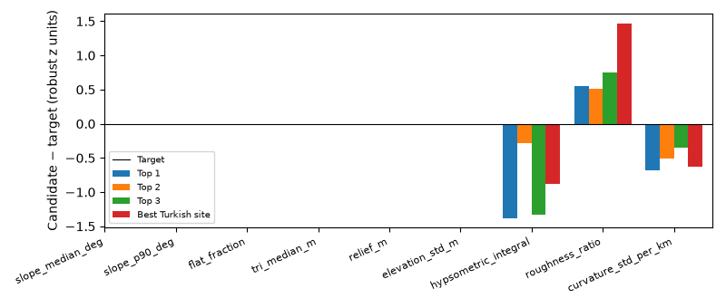

# T-01: Jezero

- Body: mars; coordinates: 18.38, 77.58
- DEM source: MOLA MEGDR + measured-bin mask; version: MGS-M-MOLA-5-MEGDR-L3-V1.0; product version 2.0
- Processing method: measured_only_planefit_v1; confidence: low
- Measurement support: `{"raw_unmeasured_ratio": 0.23319999999999996, "effective_nodata_ratio": 0.2248, "raw_unmeasured_percent": 23.319999999999997, "effective_nodata_percent": 22.48, "min_measured_neighbors": 6, "sensitivity_passed": 5, "sensitivity_total": 6, "sensitivity_failures": ["slope_p90_deg"], "sensitivity_summary": "5/6 features within thresholds"}`
- Grid: **regional subset**; scanned-cell extent `{'lat_min': -24.75, 'lat_max': 64.75, 'lon_min': -69.75, 'lon_max': 34.75}`

Topographic similarity only (slope, roughness, relief). Not compared: temperature, ice/volatiles, mineralogy, atmosphere.

## Local

Unscorable: resolution_not_validated.

## Regional

- Discrimination: `poorly_discriminated`
- Terrain commonality: `{"eligible_cells": 216, "count_ge_90": 93, "share_ge_90": 0.4305555555555556, "count_ge_80": 116, "share_ge_80": 0.5370370370370371, "explanation": "This terrain type is common in the scanned area (43.1% of cells ≥ 90); topography alone does not single out an analog — non-topographic properties (e.g. ground ice, temperature) would be needed.", "contextual_factor": 0.5162037037037037}`
- Method sensitivity: Spearman 0.9970873371770232; top-10 Jaccard 0.8181818181818182; max Turkish-site rank shift 9

### Top 10 Earth candidates

| Candidate | Nearest place | Contextual terrain (90% interval) | Raw geo | Relative | Match | Strongest / weakest |
|---|---|---:|---:|---:|---|---|
| earth_grid_r256_c429 | Misli, Nigde, TR | 51.6 (51.4–51.6) | 99.9 | 100.0 | absolute_strong | relief_m, flat_fraction / tri_median_m, slope_median_deg |
| earth_grid_r309_c320 | Saudarkrokur, Northwest, IS | 51.4 (51.2–51.5) | 99.6 | 95.0 | absolute_strong | relief_m, flat_fraction / elevation_std_m, tri_median_m |
| earth_grid_r256_c419 | Civril, Denizli, TR | 51.4 (51.1–51.5) | 99.5 | 93.9 | absolute_strong | tri_median_m, slope_median_deg / elevation_std_m, relief_m |
| earth_grid_r249_c426 | Pyrgos, Limassol, CY | 51.3 (51.0–51.4) | 99.4 | 92.4 | absolute_strong | tri_median_m, flat_fraction / relief_m, elevation_std_m |
| earth_grid_r256_c423 | Argithani, Konya, TR | 51.3 (51.0–51.4) | 99.3 | 92.2 | absolute_strong | tri_median_m, slope_median_deg / elevation_std_m, relief_m |
| earth_grid_r131_c220 | Antofagasta, Antofagasta, CL | 51.2 (50.9–51.4) | 99.3 | 91.9 | absolute_strong | relief_m, slope_median_deg / flat_fraction, elevation_std_m |
| earth_grid_r259_c422 | Beylikova, Eskisehir, TR | 50.9 (50.4–51.1) | 98.6 | 86.8 | absolute_strong | tri_median_m, relief_m / elevation_std_m, flat_fraction |
| earth_grid_r256_c414 | Menderes, Izmir, TR | 50.8 (50.2–51.0) | 98.3 | 85.6 | absolute_strong | relief_m, elevation_std_m / tri_median_m, slope_median_deg |
| earth_grid_r253_c417 | Dalaman, Mugla, TR | 50.7 (50.2–51.0) | 98.3 | 85.3 | absolute_strong | tri_median_m, slope_median_deg / elevation_std_m, relief_m |
| earth_grid_r259_c428 | Salmanli, Yozgat, TR | 50.6 (50.2–50.9) | 98.1 | 84.4 | absolute_strong | relief_m, tri_median_m / flat_fraction, elevation_std_m |

Top tier: 6 candidates with a 90% score interval overlapping the top-ranked candidate.

### Plausibility: target and top 3 raw feature values

| Feature | Target raw | Top 1 raw (sᵢ) | Top 2 raw (sᵢ) | Top 3 raw (sᵢ) |
|---|---:|---:|---:|---:|
| slope_median_deg | 1.441 | 1.309 (0.999) | 1.775 (0.995) | 1.586 (0.999) |
| flat_fraction | 0.8421 | 0.8524 (1.000) | 0.8688 (0.997) | 0.8088 (0.997) |
| tri_median_m | 75.36 | 62.73 (0.996) | 94.05 (0.994) | 81.81 (0.999) |
| relief_m | 805.8 | 797.1 (1.000) | 781.9 (1.000) | 712.1 (0.995) |
| elevation_std_m | 275.6 | 263.1 (0.999) | 237.1 (0.991) | 231.7 (0.988) |

### Turkish sites

| Site | Nearest place | Contextual terrain | Raw geo | Relative |
|---|---|---:|---:|---:|
| Kula | Menye, Manisa, TR | 50.6 | 98.0 | 84.0 |
| Salda | Yesilova, Burdur, TR | 49.6 | 96.2 | 77.7 |
| Hassa | Asagi Karafakili, Hatay, TR | 45.3 | 87.8 | 63.6 |
| Meke Maar | Karapinar, Konya, TR | 43.5 | 84.3 | 60.0 |
| Tuz Golu | Sereflikochisar, Ankara, TR | 9.9 | 19.1 | 31.3 |

### Where the analogy breaks

- Earth gravity 9.81 m/s²; mars gravity 3.71 m/s²
- Earth surface pressure 101.3 kPa; mars surface pressure 0.6 kPa
- Thin CO2 atmosphere
- No global magnetic field — higher surface radiation
- slope_p90_deg excluded — measured-only vs interpolated difference 15.44% / 0.912° exceeds thresholds
- hypsometric_integral excluded — shape feature sensitivity not delivered
- roughness_ratio excluded — shape feature sensitivity not delivered
- curvature_std_per_km excluded — shape feature sensitivity not delivered

### Not compared

- slope_p90_deg: slope_p90_deg excluded — measured-only vs interpolated difference 15.44% / 0.912° exceeds thresholds
- hypsometric_integral: hypsometric_integral excluded — shape feature sensitivity not delivered
- roughness_ratio: roughness_ratio excluded — shape feature sensitivity not delivered
- curvature_std_per_km: curvature_std_per_km excluded — shape feature sensitivity not delivered
- temperature: not in the topographic comparison
- ice/volatiles: not in the topographic comparison
- mineralogy: not in the topographic comparison
- atmosphere: not in the topographic comparison

