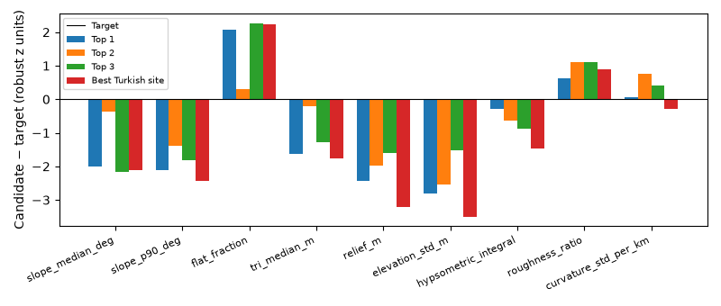

# T-02: Shackleton

- Body: moon; coordinates: -89.67, 129.78
- DEM source: lola; version: LRO-L-LOLA-4-GDR-V1.0; LDEM_75S_240M V2.0 (2017)
- Processing method: metric-gradient-riley8-p95p5-v1; confidence: high
- Measurement support: `null`
- Grid: **regional subset**; scanned-cell extent `{'lat_min': -24.75, 'lat_max': 64.75, 'lon_min': -69.75, 'lon_max': 34.75}`

Topographic similarity only (slope, roughness, relief). Not compared: temperature, ice/volatiles, mineralogy, atmosphere.

## Local

- Discrimination: `uniformly_dissimilar`
- Terrain commonality: `{"eligible_cells": 0, "count_ge_90": 0, "share_ge_90": null, "count_ge_80": 0, "share_ge_80": null, "explanation": null}`

### Top 10 Earth candidates

| Candidate | Nearest place | Score geo (90% interval) | Relative | Match | Strongest / weakest |
|---|---|---:|---:|---|---|
| earth_atacama_local | Antofagasta, Antofagasta, CL | 1.0 (1.0–1.0) | 100.0 | relative_only | flat_fraction, slope_p90_deg / slope_median_deg, relief_m |
| earth_salda_local | Yesilova, Burdur, TR | 1.0 (1.0–1.0) | 87.3 | weak | flat_fraction, slope_p90_deg / slope_median_deg, relief_m |
| earth_hassa_local | Asagi Karafakili, Hatay, TR | 1.0 (1.0–1.0) | 83.7 | weak | flat_fraction, slope_p90_deg / slope_median_deg, tri_median_m |
| earth_kula_local | Menye, Manisa, TR | 1.0 (1.0–1.0) | 72.3 | weak | flat_fraction, slope_p90_deg / slope_median_deg, relief_m |
| earth_meke_local | Karapinar, Konya, TR | 1.0 (1.0–1.0) | 53.6 | weak | flat_fraction, slope_p90_deg / slope_median_deg, relief_m |
| earth_haughton_local | Gjoa Haven, Nunavut, CA | 1.0 (1.0–1.0) | 45.9 | weak | flat_fraction, slope_p90_deg / slope_median_deg, relief_m |
| earth_meteor_crater_local | LeChee, Arizona, US | 1.0 (1.0–1.0) | 39.8 | weak | flat_fraction, slope_p90_deg / slope_median_deg, relief_m |
| earth_tuz_golu_local | Sereflikochisar, Ankara, TR | 1.0 (1.0–1.0) | 33.2 | weak | flat_fraction, slope_p90_deg / slope_median_deg, relief_m |

### Turkish sites

| Site | Nearest place | Score geo | Relative |
|---|---|---:|---:|
| Salda | Yesilova, Burdur, TR | 1.0 | 87.3 |
| Hassa | Asagi Karafakili, Hatay, TR | 1.0 | 83.7 |
| Kula | Menye, Manisa, TR | 1.0 | 72.3 |
| Meke Maar | Karapinar, Konya, TR | 1.0 | 53.6 |
| Tuz Golu | Sereflikochisar, Ankara, TR | 1.0 | 33.2 |

### Where the analogy breaks

- Earth gravity 9.81 m/s²; moon gravity 1.62 m/s²
- Earth surface pressure 101.3 kPa; moon surface pressure 0.0 kPa
- Near-vacuum
- No atmosphere or magnetic field — direct radiation and micrometeoroid exposure
- Extreme day/night temperature swings; permanently shadowed regions far colder than any Earth surface

### Not compared

- temperature: not in the topographic comparison
- ice/volatiles: not in the topographic comparison
- mineralogy: not in the topographic comparison
- atmosphere: not in the topographic comparison

## Regional

- Discrimination: `uniformly_dissimilar`
- Terrain commonality: `{"eligible_cells": 216, "count_ge_90": 0, "share_ge_90": 0.0, "count_ge_80": 0, "share_ge_80": 0.0, "explanation": null}`

### Top 10 Earth candidates

| Candidate | Nearest place | Score geo (90% interval) | Relative | Match | Strongest / weakest |
|---|---|---:|---:|---|---|
| earth_grid_r254_c429 | Camliyayla, Mersin, TR | 62.0 (51.0–69.4) | 100.0 | absolute_moderate | tri_median_m, relief_m / slope_p90_deg, elevation_std_m |
| earth_grid_r253_c420 | Altinyaka, Antalya, TR | 18.1 (9.6–29.8) | 56.5 | relative_only | tri_median_m, flat_fraction / elevation_std_m, relief_m |
| earth_grid_r253_c424 | Koprulu, Antalya, TR | 16.4 (7.9–25.7) | 55.0 | relative_only | tri_median_m, flat_fraction / elevation_std_m, relief_m |
| earth_grid_r256_c416 | Kiraz, Izmir, TR | 4.0 (2.8–5.8) | 36.5 | relative_only | tri_median_m, flat_fraction / elevation_std_m, relief_m |
| earth_hassa_regional | Asagi Karafakili, Hatay, TR | 2.3 (1.5–3.1) | 34.3 | weak | tri_median_m, slope_median_deg / elevation_std_m, relief_m |
| earth_grid_r130_c221 | Taltal, Antofagasta, CL | 1.9 (1.2–3.0) | 33.1 | weak | relief_m, elevation_std_m / flat_fraction, slope_p90_deg |
| earth_grid_r259_c413 | Evciler, Canakkale, TR | 1.0 (1.0–1.2) | 27.2 | weak | tri_median_m, slope_p90_deg / elevation_std_m, flat_fraction |
| earth_grid_r256_c421 | Barla, Isparta, TR | 1.1 (1.0–1.6) | 27.0 | weak | tri_median_m, slope_p90_deg / elevation_std_m, relief_m |
| earth_grid_r250_c411 | Skhisma, Crete, GR | 1.0 (1.0–1.2) | 25.9 | weak | slope_p90_deg, flat_fraction / slope_median_deg, tri_median_m |
| earth_grid_r249_c425 | Pachna, Limassol, CY | 1.0 (1.0–1.0) | 25.8 | weak | tri_median_m, slope_p90_deg / flat_fraction, relief_m |

### Turkish sites

| Site | Nearest place | Score geo | Relative |
|---|---|---:|---:|
| Hassa | Asagi Karafakili, Hatay, TR | 2.3 | 34.3 |
| Salda | Yesilova, Burdur, TR | 1.0 | 25.1 |
| Kula | Menye, Manisa, TR | 1.0 | 22.8 |
| Meke Maar | Karapinar, Konya, TR | 1.0 | 18.9 |
| Tuz Golu | Sereflikochisar, Ankara, TR | 1.0 | 17.0 |

### Where the analogy breaks

- Earth gravity 9.81 m/s²; moon gravity 1.62 m/s²
- Earth surface pressure 101.3 kPa; moon surface pressure 0.0 kPa
- Near-vacuum
- No atmosphere or magnetic field — direct radiation and micrometeoroid exposure
- Extreme day/night temperature swings; permanently shadowed regions far colder than any Earth surface

### Not compared

- temperature: not in the topographic comparison
- ice/volatiles: not in the topographic comparison
- mineralogy: not in the topographic comparison
- atmosphere: not in the topographic comparison

