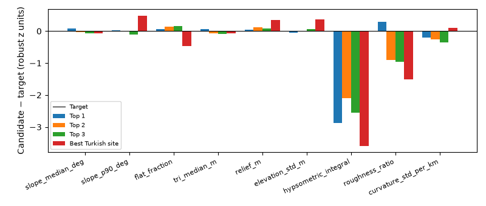

# T-04: Phoenix regional feasibility probe

- Body: mars; coordinates: 68.2, -125.69999999999999
- DEM source: MOLA MEGDR + measured-bin mask; version: MGS-M-MOLA-5-MEGDR-L3-V1.0; product version 2.0
- Processing method: measured_only_planefit_v1; confidence: high
- Measurement support: `{"raw_unmeasured_ratio": 0.07920000000000005, "effective_nodata_ratio": 0.04920000000000002, "raw_unmeasured_percent": 7.920000000000005, "effective_nodata_percent": 4.920000000000002, "min_measured_neighbors": 6, "sensitivity_passed": 6, "sensitivity_total": 6, "sensitivity_failures": [], "sensitivity_summary": "all 6 features within thresholds"}`
- Grid: **regional subset**; scanned-cell extent `{'lat_min': -24.75, 'lat_max': 64.75, 'lon_min': -69.75, 'lon_max': 34.75}`

Topographic similarity only (slope, roughness, relief). Not compared: temperature, ice/volatiles, mineralogy, atmosphere.

## Regional

- Discrimination: `poorly_discriminated`
- Terrain commonality: `{"eligible_cells": 216, "count_ge_90": 37, "share_ge_90": 0.1712962962962963, "count_ge_80": 71, "share_ge_80": 0.3287037037037037, "explanation": "This terrain type is common in the scanned area (17.1% of cells ≥ 90); topography alone does not single out an analog — non-topographic properties (e.g. ground ice, temperature) would be needed.", "contextual_factor": 0.75}`
- Method sensitivity: Spearman 0.9987945761264145; top-10 Jaccard 1.0; max Turkish-site rank shift 11

### Top 10 Earth candidates

| Candidate | Nearest place | Contextual terrain (90% interval) | Raw geo | Relative | Match | Strongest / weakest |
|---|---|---:|---:|---:|---|---|
| earth_grid_r258_c422 | Umraniye, Afyonkarahisar, TR | 74.7 (73.3–74.7) | 99.6 | 100.0 | absolute_strong | slope_p90_deg, elevation_std_m / flat_fraction, slope_median_deg |
| earth_grid_r240_c428 | Mitzpe Ramon, Southern District, IL | 74.3 (72.7–74.6) | 99.1 | 94.6 | absolute_strong | elevation_std_m, slope_p90_deg / flat_fraction, relief_m |
| earth_grid_r240_c424 | Ismailia, Al Isma'iliyah, EG | 74.0 (71.5–74.5) | 98.7 | 92.2 | absolute_strong | elevation_std_m, slope_median_deg / flat_fraction, slope_p90_deg |
| earth_grid_r255_c426 | Hotamis, Konya, TR | 73.9 (71.5–74.4) | 98.5 | 90.8 | absolute_strong | elevation_std_m, relief_m / slope_median_deg, tri_median_m |
| earth_grid_r240_c417 | Al `Alamayn, Muhafazat Matruh, EG | 73.5 (70.8–74.1) | 98.1 | 88.4 | absolute_strong | relief_m, slope_median_deg / slope_p90_deg, elevation_std_m |
| earth_grid_r258_c429 | Karahasanli, Nevsehir, TR | 73.2 (71.1–73.9) | 97.6 | 86.2 | absolute_strong | relief_m, slope_p90_deg / tri_median_m, slope_median_deg |
| earth_grid_r243_c429 | Bene 'Ayish, Central District, IL | 72.8 (70.1–73.7) | 97.1 | 84.1 | absolute_strong | slope_median_deg, tri_median_m / relief_m, flat_fraction |
| earth_grid_r250_c427 | Lefkonoiko, Ammochostos, CY | 71.9 (69.2–73.1) | 95.9 | 80.5 | absolute_strong | slope_median_deg, relief_m / slope_p90_deg, flat_fraction |
| earth_grid_r259_c412 | Geyikli, Canakkale, TR | 69.1 (66.0–70.9) | 92.1 | 72.0 | absolute_strong | flat_fraction, slope_median_deg / slope_p90_deg, elevation_std_m |
| earth_haughton_regional | Gjoa Haven, Nunavut, CA | 68.9 (65.4–70.8) | 91.8 | 71.6 | absolute_strong | elevation_std_m, relief_m / slope_p90_deg, tri_median_m |

Top tier: 18 candidates with a 90% score interval overlapping the top-ranked candidate.

### Plausibility: target and top 3 raw feature values

| Feature | Target raw | Top 1 raw (sᵢ) | Top 2 raw (sᵢ) | Top 3 raw (sᵢ) |
|---|---:|---:|---:|---:|
| slope_median_deg | 0.5178 | 0.6501 (0.994) | 0.561 (0.999) | 0.6265 (0.996) |
| slope_p90_deg | 1.819 | 1.93 (0.999) | 1.48 (0.986) | 1.796 (1.000) |
| flat_fraction | 0.9794 | 0.9868 (0.988) | 0.9936 (0.968) | 0.9988 (0.968) |
| tri_median_m | 26.66 | 31.55 (0.997) | 28.16 (1.000) | 31.27 (0.997) |
| relief_m | 243.4 | 266.9 (0.997) | 233.2 (0.999) | 290.5 (0.989) |
| elevation_std_m | 88.38 | 81.62 (0.997) | 79.9 (0.996) | 90.31 (1.000) |

### Turkish sites

| Site | Nearest place | Contextual terrain | Raw geo | Relative |
|---|---|---:|---:|---:|
| Meke Maar | Karapinar, Konya, TR | 69.2 | 92.3 | 72.4 |
| Kula | Menye, Manisa, TR | 50.2 | 67.0 | 50.1 |
| Tuz Golu | Sereflikochisar, Ankara, TR | 47.3 | 63.1 | 48.1 |
| Salda | Yesilova, Burdur, TR | 43.8 | 58.4 | 46.0 |
| Hassa | Asagi Karafakili, Hatay, TR | 29.9 | 39.8 | 38.9 |

### Where the analogy breaks

- Earth gravity 9.81 m/s²; mars gravity 3.71 m/s²
- Earth surface pressure 101.3 kPa; mars surface pressure 0.6 kPa
- Thin CO2 atmosphere
- No global magnetic field — higher surface radiation
- hypsometric_integral excluded — shape feature sensitivity not delivered
- roughness_ratio excluded — shape feature sensitivity not delivered
- curvature_std_per_km excluded — shape feature sensitivity not delivered

### Not compared

- hypsometric_integral: hypsometric_integral excluded — shape feature sensitivity not delivered
- roughness_ratio: roughness_ratio excluded — shape feature sensitivity not delivered
- curvature_std_per_km: curvature_std_per_km excluded — shape feature sensitivity not delivered
- temperature: not in the topographic comparison
- ice/volatiles: not in the topographic comparison
- mineralogy: not in the topographic comparison
- atmosphere: not in the topographic comparison

