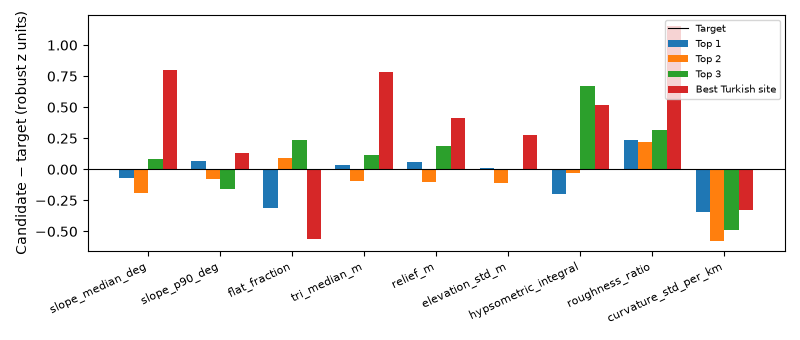

# T-05: Arcadia regional feasibility probe

- Body: mars; coordinates: 40.0, -170.0
- DEM source: MOLA MEGDR + measured-bin mask; version: MGS-M-MOLA-5-MEGDR-L3-V1.0; product version 2.0
- Processing method: measured_only_planefit_v1; confidence: medium
- Measurement support: `{"raw_unmeasured_ratio": 0.2056, "effective_nodata_ratio": 0.19479999999999997, "raw_unmeasured_percent": 20.560000000000002, "effective_nodata_percent": 19.479999999999997, "min_measured_neighbors": 6, "sensitivity_passed": 6, "sensitivity_total": 6, "sensitivity_failures": [], "sensitivity_summary": "all 6 features within thresholds"}`
- Grid: **regional subset**; scanned-cell extent `{'lat_min': -24.75, 'lat_max': 64.75, 'lon_min': -69.75, 'lon_max': 34.75}`

Topographic similarity only (slope, roughness, relief). Not compared: temperature, ice/volatiles, mineralogy, atmosphere.

## Regional

- Discrimination: `poorly_discriminated`
- Terrain commonality: `{"eligible_cells": 216, "count_ge_90": 40, "share_ge_90": 0.18518518518518517, "count_ge_80": 68, "share_ge_80": 0.3148148148148148, "explanation": "This terrain type is common in the scanned area (18.5% of cells ≥ 90); topography alone does not single out an analog — non-topographic properties (e.g. ground ice, temperature) would be needed."}`
- Method sensitivity: Spearman 0.9985746316463804; top-10 Jaccard 1.0; max Turkish-site rank shift 6

### Top 10 Earth candidates

| Candidate | Nearest place | Score geo (90% interval) | Relative | Match | Strongest / weakest |
|---|---|---:|---:|---|---|
| earth_grid_r255_c423 | Beysehir, Konya, TR | 99.2 (97.7–99.6) | 100.0 | absolute_strong | slope_p90_deg, flat_fraction / slope_median_deg, elevation_std_m |
| earth_grid_r257_c415 | Halitpasa, Manisa, TR | 99.1 (97.5–99.5) | 99.6 | absolute_strong | elevation_std_m, tri_median_m / flat_fraction, slope_median_deg |
| earth_atacama_regional | Antofagasta, Antofagasta, CL | 98.5 (96.8–99.1) | 95.8 | absolute_strong | elevation_std_m, slope_median_deg / flat_fraction, relief_m |
| earth_grid_r259_c423 | Gelegra, Ankara, TR | 97.7 (95.7–98.7) | 93.1 | absolute_strong | elevation_std_m, relief_m / tri_median_m, slope_median_deg |
| earth_grid_r258_c427 | Savcili, Kirsehir, TR | 97.7 (95.9–98.7) | 93.0 | absolute_strong | relief_m, elevation_std_m / flat_fraction, slope_median_deg |
| earth_grid_r308_c320 | Vestmannaeyjar, South, IS | 97.7 (95.7–98.6) | 92.8 | absolute_strong | relief_m, slope_median_deg / flat_fraction, slope_p90_deg |
| earth_grid_r241_c429 | Midreshet Ben-Gurion, Southern District, IL | 95.9 (92.4–97.3) | 87.7 | absolute_strong | relief_m, tri_median_m / flat_fraction, slope_p90_deg |
| earth_grid_r258_c419 | Aslanapa, Kuetahya, TR | 95.4 (93.0–97.1) | 86.7 | absolute_strong | slope_p90_deg, flat_fraction / slope_median_deg, tri_median_m |
| earth_grid_r253_c416 | Marmaris, Mugla, TR | 92.3 (87.0–95.0) | 80.8 | absolute_strong | tri_median_m, relief_m / flat_fraction, slope_median_deg |
| earth_grid_r250_c426 | Mammari, Lefkosia, CY | 91.6 (88.3–93.5) | 79.8 | absolute_strong | relief_m, elevation_std_m / slope_median_deg, tri_median_m |

### Turkish sites

| Site | Nearest place | Score geo | Relative |
|---|---|---:|---:|
| Meke Maar | Karapinar, Konya, TR | 86.8 | 74.1 |
| Kula | Menye, Manisa, TR | 82.7 | 70.4 |
| Tuz Golu | Sereflikochisar, Ankara, TR | 50.1 | 52.2 |
| Salda | Yesilova, Burdur, TR | 49.5 | 52.2 |
| Hassa | Asagi Karafakili, Hatay, TR | 8.7 | 34.2 |

### Where the analogy breaks

- Earth gravity 9.81 m/s²; mars gravity 3.71 m/s²
- Earth surface pressure 101.3 kPa; mars surface pressure 0.6 kPa
- Thin CO2 atmosphere
- No global magnetic field — higher surface radiation

### Not compared

- temperature: not in the topographic comparison
- ice/volatiles: not in the topographic comparison
- mineralogy: not in the topographic comparison
- atmosphere: not in the topographic comparison

